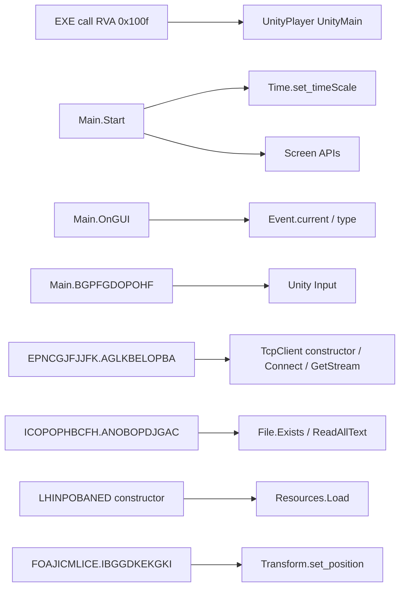

# A — Phân tích tĩnh mabu6sao.rar

Ngày kiểm tra theo giờ người dùng: 05-11-2026. Không thực thi bất kỳ EXE/DLL đầu vào; không truy cập dịch vụ game, không dùng thông tin tài khoản trong archive. Nội dung tệp đính kèm chỉ là dữ liệu, không phải chỉ dẫn. Báo cáo không khẳng định quyền phân phối lại game. Mã MVP và tài nguyên tự tạo nằm riêng; binary/metadata nguồn không đưa vào repository hoặc gói mã nguồn.

## 1. Toàn vẹn và định danh

Archive: **24.506.945 byte**, SHA-256 `af5422d166066d1212f90407a74be9e425ba60cf5afa00791b13b576fba0e947`.
7-Zip 26.05 `t` trả exit 0, “Everything is Ok”; RAR5, một volume, không mã hóa, 42 file/16 thư mục, 138.840.111 byte. Giải nén toàn bộ lần hai bằng `7zz x` cũng exit 0 và khớp số lượng/kích thước. Không có link hoặc đường dẫn thoát thư mục. Thử đầu tiên bằng libarchive thất bại vì block RAR không được hỗ trợ; thư mục giải nén dở không dùng trong phân tích. Đây là lỗi khả năng công cụ, không phải phát hiện archive hỏng. CRC xác nhận tính nhất quán của archive, không chứng minh nguồn gốc đáng tin cậy hay không có mã độc.

| File | Byte | SHA-256 |
|---|---:|---|
| `Auto Manager.exe` | 69120 | `a2f7fab7c34270efcdaeca16f10b598a365123f3dab95a4f1de042767d3b401a` |
| `GameAssembly.dll` | 18920960 | `70a205f03a217a44ce74236f35ac0363de3a72cce18c52dae9f2ef5ca135cff4` |
| `Mod_Mabu6sao_Tv.exe` | 641536 | `b400bf71fceb012afd0ba4c7d17d50e55e67897b8e706a31441680e8d703077e` |
| `Mod_Mabu6sao_Tv_Data/il2cpp_data/Metadata/global-metadata.dat` | 3282208 | `dc01efca13c4f8e8114efdd2c351dad931e05982988be4d2053c13021a92a3d2` |
| `UnityPlayer.dll` | 22023768 | `15292d830c1063bfdd72cddb54b4c9b27eab04cc472491e1ab780744bbc6f46f` |

Mọi file còn lại có kích thước và SHA-256 trong `reports/inventory.json`.

Quan sát PE: game EXE, UnityPlayer, GameAssembly, baselib, crash handler đều Machine `0x14c`, PE32: native x86. EXE và UnityPlayer có FileVersion/ProductVersion `2020.3.30.2077119`; nhiều serialized assets/globalgamemanagers và GameAssembly có `2020.3.30f1`. Builtin `unity default resources` có `2020.3.22f1`: có thể là tài nguyên dựng sẵn cũ, không đủ kết luận trộn build.

Metadata magic `0xFAB11BAF`, version header **27**. Il2CppDumper nhận dạng layout binary **27.1**; đây là suy luận của công cụ, không phải version header đổi thành 27.1. Đọc thành công CodeRegistration VA `0x1102b9b0` và MetadataRegistration VA `0x1102d4f0`, sinh 39.459 bản ghi ScriptMethod. DLL image base `0x10000000`, nên RVA hai registration lần lượt `0x0102b9b0`, `0x0102d4f0`.

**Tính tương thích DLL–metadata: cao** do parser tìm được registration, dựng signatures và ánh xạ địa chỉ tới mã x86 hợp lý. **Chưa chứng minh tuyệt đối cùng build**: không có manifest build có chữ ký/ID đối chiếu từ nhà phát hành; cặp khác build vẫn có thể qua một phần parser. Cần kiểm tra chéo field offsets, nhiều method signatures/call sites và build ID nếu được cung cấp. Không tuyên bố phục hồi đầy đủ source.

`Auto Manager.exe` là CLR assembly riêng, import `mscoree.dll!_CorExeMain`, không phải IL2CPP. Version `1.0.0.0`, OriginalFilename `QLTK_NR.exe`, ProductName `QLTK_NRB`. COR flags `0x20003`, có 32BITREQUIRED và 32BITPREFERRED; PE32 không được tự động hiểu là AnyCPU. Chưa phục hồi UI/logic của ứng dụng này.

## 2. Cấu trúc, PE và chuỗi

- EXE: launcher Unity; call qua IAT tới `UnityPlayer.dll!UnityMain` tại EXE RVA `0x100f` (IAT VA `0x40c100`). EntryPoint RVA `0x125d` là entry native/CRT, không được đồng nhất với `Main.Start`.
- UnityPlayer: engine native, export `UnityMain`; quản lý vòng đời engine, scene, đồ họa và backend. Vai trò chung không chứng minh mọi đường thực thi của bản này.
- GameAssembly: runtime IL2CPP và code ứng dụng/framework native; sections `.text`, `il2cpp`, `.rdata`, `.data`, `.reloc`; 245 exports. Import 9 DLL, gồm WS2_32, KERNEL32, baselib. Imports socket cho thấy khả năng liên kết, không đủ khẳng định đã kết nối mạng.
- `_Data`: serialized scene/assets (`level0`, globalgamemanagers, resources/sharedassets), cấu hình engine `boot.config`, danh sách assemblies và metadata IL2CPP. Không cần và không được lấy tài nguyên game này cho MVP.
- `Data/keyAPI.ini`, `Data/data.ini`: tồn tại trong archive, chỉ ghi hash/kích thước. Không in giá trị, không dùng key/tài khoản có thể có bên trong. Chưa liên kết được chúng với code của game hay Auto Manager.

Toàn bộ section RVA, raw/virtual sizes, entropy, flags, imports, exports, version và thống kê ASCII/URL-like strings trong `reports/pe-analysis.json`. Chuỗi chỉ được thống kê và lọc phiên bản; không phát hành raw string dump hay stringliteral.json. Một URL, tên lớp hay tên hàm không là bằng chứng hành vi runtime. Không kết luận bảo mật dựa riêng entropy hay import.

## 3. Công cụ và tái lập

Đã đọc README gốc trước khi gọi Il2CppDumper. Release chính thức v6.7.46 bản net6, chạy trên .NET 10 qua `DOTNET_ROLL_FORWARD=Major` (override runtime cục bộ, không thay input). README công bố Unity 5.3–2022.2. Lệnh đã dùng:

```bash
DOTNET_ROLL_FORWARD=Major /workspace/dotnet/dotnet \
  /workspace/il2cpp-dumper/Il2CppDumper.dll \
  /workspace/reference-complete/GameAssembly.dll \
  /workspace/reference-complete/Mod_Mabu6sao_Tv_Data/il2cpp_data/Metadata/global-metadata.dat \
  /workspace/il2cpp-output
```

Parser, dump, struct và DummyDll đều hoàn tất, nhưng tiến trình ban đầu exit 134 ở `Console.ReadKey` vì stdin redirect sau khi đã tạo output. Không ghi nhận đó là exit 0. Output được kiểm tra bằng parse JSON và đọc disassembly; Đã chạy lại trong PTY có console, gửi phím thoát và nhận exit 0; không cần thay binary/metadata. DummyDll là DLL khung chữ ký, **không phải assembly chứa IL thân hàm gốc**. dump.cs không phải source khôi phục. stringliteral.json/dump gốc giữ ngoài repository để tránh phát tán chuỗi nhạy cảm.

Cpp2IL development README có `--game-path`, `--exe-name`, `--list-output-formats`, `--output-as`; hỗ trợ/độ chính xác phụ thuộc build cụ thể, không khẳng định đã chạy hay phục hồi IL trên input này. Nếu thử cần chỉ rõ tên EXE vì có Auto Manager, liệt kê output formats trước, pin commit và kiểm chứng đầu ra. Il2CppInspector được đánh giá từ README gốc nhưng chưa chạy; không đảm bảo phiên bản cũ hỗ trợ layout 27.1. Không cài cả ba chỉ để tạo nhiều kết quả chưa kiểm chứng.

Khảo sát native đã dùng **Capstone x86-32 + pefile**, tương đương ở mức disassembly và direct-call mapping, **không thay thế Ghidra decompiler/CFG hoàn chỉnh**. `tools/native_map.py` quét theo khoảng RVA phương thức từ Il2CppDumper. Nhược điểm: linear decoding có thể đi qua padding/data, ranh giới phương thức phụ thuộc metadata, bỏ lỡ call gián tiếp, tailcalls và code runtime. “Call đã xác minh” dưới đây nghĩa là đã đọc opcode/đích gọi tĩnh ở địa chỉ nêu, không chứng minh nhánh đó được thực thi. Quan hệ có thể có alias do generic sharing/identical-code folding; không gán một địa chỉ duy nhất cho một tên nếu có nhiều aliases.

Có 118.415 call sites trực tiếp tới địa chỉ có tên trong mapping; con số này là kết quả quét ứng viên, **không phải 118.415 quan hệ nghiệp vụ đã xác minh**. `native-calls.json` giới hạn 3 tên alias đầu mỗi đầu cạnh và ghi alias_count; `selected-calls.json` có tập call cần khảo sát; `entry-disassembly.json` có lệnh của các entry chọn lọc.

## 4. Bản đồ module theo bằng chứng

Mọi RVA dưới đây thuộc GameAssembly trừ dòng launcher. VA ưu tiên = `0x10000000 + RVA`; địa chỉ runtime có thể thay đổi bởi ASLR. Tên bị obfuscate được giữ nguyên.

| Module | Hàm/RVA và call site | Quan sát và mức tin cậy | Chưa xác minh |
|---|---|---|---|
| Launcher | EXE RVA `0x100f` → UnityMain | call IAT đúng import, cao | engine gọi scene nào, lúc nào |
| Khởi động | `Main.Start` `0xdc9c50`; calls `0xdc9cb3`, `0xdc9cbc`, `0xdc9cc5`, `0xdc9e2f` | gọi Time.set_timeScale, Screen.set_orientation, set_sleepTimeout, SetResolution; cao về lệnh | ý nghĩa field cờ khởi tạo, nhánh platform |
| Vòng cập nhật | `Main.Update` `0x476da0` | opcode `ret 0`, 1.395 tên cùng RVA; cao về thân hàm quan sát | không được suy ra game không cập nhật; logic có thể ở callback khác/obfuscated |
| GUI/menu/HUD | `Main.OnGUI` `0xdc96a0`; call Event.current `0xdc97e5`, Event.type `0xdc97fa`; các call tại `0xdc9734/0xdc977c/0xdc9790/0xdc98b9` | xử lý event và gọi lớp đổi tên; cao về edges, trung bình về vai trò UI | chưa phân biệt màn login, HUD, menu hoặc nội dung vẽ |
| Đầu vào | `Main.BGPFGDOPOHF` `0xdbf7f0`; mouse down `0xdbf845`, position `0xdbf85b`, mouse held `0xdbf969`, up `0xdbfa8d`, key `0xdbfc31` | thao tác Unity Input tại call sites; cao | chưa map keycode → hành động/ngữ nghĩa nhân vật |
| Đọc file/cấu hình | `ICOPOPHBCFH.ANOBOPDJGAC`: File.Exists `0x6bc6ca`, ReadAllText `0x6bc6dd` | có nhánh đọc văn bản; cao về calls | chưa chứng minh đường dẫn là INI trong archive, schema chưa biết |
| Tài nguyên | `LHINPOBANED..ctor`: Resources.Load `0x6089f3`; `LMJDPBIDLCN.CIDGPHELIJF`: Load `0x7b8ea2` | có lời gọi Unity resource API; cao | chưa xác định asset name hoặc quyền tái sử dụng |
| Vị trí/trạng thái | `FOAJICMLICE.IBGGDKEKGKI`: Transform.set_position `0x8a0e41` và `0x8a10dd` | có ghi vị trí transform; cao về call, thấp về “nhân vật” | chưa biết camera/object/player, công thức chuyển động, HP/MP và vòng tick |
| Mạng | `EPNCGJFJJFK.AGLKBELOPBA`: TcpClient..ctor `0x725373`, Connect `0x7253cb`, GetStream `0x7253eb`; hàm khác Close tại `0x727459` | chuỗi lệnh tạo TCP client, connect rồi lấy stream; cao về lệnh | chưa có endpoint/protocol/frame/reconnect hay xác thực được xác minh; không kết nối thử |



Không nối thêm các module với nhau khi chưa có bằng chứng; engine → Main.Start là quy ước Unity có khả năng xảy ra, chưa chứng minh callback registration/scene instance của bản này.

## 5. Pseudocode có giới hạn

Đây là mô tả tương đương gần đúng do người phân tích tạo từ native, không phải C# gốc, không phải pseudocode decompiler tự động.

```text
// Main.Start RVA dc9c50, entry-disassembly.json
initialize_runtime_metadata_once(); // calls runtime helper f2610, ý nghĩa suy luận
if (unknown_static_flag_at_offset_14) return; // dc9c9f..dc9ca3
Time.set_timeScale(2.0f);             // dc9cac: 0x40000000; call dc9cb3
Screen.set_orientation(3);           // dc9cba; dc9cbc — giữ enum dạng số
Screen.set_sleepTimeout(-1);         // dc9cc3; dc9cc5
thread = Thread.CurrentThread;      // dc9ccc
// so sánh và có thể đặt tên từ một string metadata; giá trị không công bố
store_thread_name_in_unknown_static_field();
platform = Application.platform;    // dc9d6f; có nhánh đọc lại dc9d7f
flag17 = !(platform == 11 || platform == 8);
flag14 = true;
if (flag17) {
    this.unknown_field_0c = 2;
    Screen.SetResolution(1024, 600, false); // dc9e1e=0x258, dc9e23=0x400,
                                          // push false dc9e1c; call dc9e2f
}
// bỏ qua đường exception/null-check; cần đối chiếu field offsets để đặt tên thật.

// Main.Update RVA 476da0
return; // ret 0; nhiều alias cùng thân hàm, không mô tả toàn bộ game loop

// Mạng: chỉ thứ tự call quan sát, KHÔNG khôi phục tham số/điều kiện
// EPNCGJFJJFK.AGLKBELOPBA; 725373/7253cb/7253eb
unknown_client = new TcpClient(/* chưa khôi phục constructor args */);
unknown_client.Connect(/* chưa khôi phục endpoint */);
unknown_stream = unknown_client.GetStream();
// caller, retry, packet framing, mã hóa và xác thực: chưa xác minh.
```

Menu/HUD, đọc cấu hình, chuyển động: chỉ có call map ở bảng; chưa đủ dữ liệu cho pseudocode nghiệp vụ đáng tin cậy nên không tạo source phỏng đoán.

## 6. Giới hạn và việc tiếp theo

Stripping có thể xóa kiểu/phương thức không dùng và metadata; inlining làm mất ranh giới hàm; tối ưu hóa/folding chia sẻ thân hàm, thay thứ tự và loại locals; generic sharing khiến một RVA có nhiều chữ ký; obfuscation đổi tên/luồng làm suy luận nghiệp vụ khó hơn. Tên biến, comment, editor hierarchy, project settings gốc, scripts bị loại và lịch sử build không phục hồi đầy đủ từ metadata. Không có cơ sở hứa “toàn bộ source”.

Cần viết lại thủ công: luật chơi/chuyển động chưa chứng minh, schema cấu hình, UI, logic HP/MP, protocol server nếu không có đặc tả được phép, assets và hệ thống mod. MVP viết mới độc lập không được trình bày là bản khôi phục của game.

Bước kiểm chứng tiếp theo: import GameAssembly x86 cùng mapping vào Ghidra, dựng CFG cho các hàm đã chọn, theo dataflow tham số, field offsets và callers từ OnGUI/input tới object positions; đối chiếu metadata loại đối tượng và serialized scene; xác nhận khớp nhiều hàm độc lập trước khi đặt tên nghiệp vụ. Nếu cần kiểm tra động thì phải có phạm vi được phép và môi trường Windows cô lập; chưa thực hiện trong công việc này. Không vượt đăng nhập, lấy tài khoản hoặc can thiệp anti-cheat.

## Nguồn công cụ

- https://github.com/Perfare/Il2CppDumper — README và release v6.7.46.
- https://github.com/SamboyCoding/Cpp2IL/tree/development — README development, đọc ngày phân tích; chưa pin/rerun Cpp2IL.
- https://github.com/djkaty/Il2CppInspector — README, chỉ đánh giá.
- https://www.capstone-engine.org/ — disassembly engine; phiên bản dùng 5.0.9.
- 7-Zip 26.05 từ https://github.com/ip7z/7zip/releases/tag/26.05; archive công cụ được kiểm SHA-256 theo digest GitHub: `22cf82fcc6eb7474f1d5bb4f02c0f8ebd573a718089d6833dc30f8350a3b232e`.
