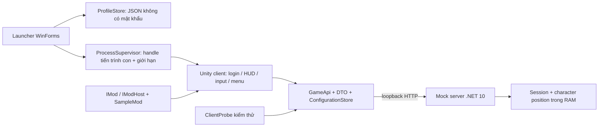

# Kiến trúc MVP v2

- Giao diện Unity: `game-client/Assets/Scripts/LocalGame.cs`, glue/controller cho scene, input và IMGUI.
- Luật game thuần C#: `game-client/Assets/Scripts/Core/World.cs`, kiểm thử riêng.
- Network/DTO/config thuần C#: `game-client/Assets/Scripts/Network/`; `shared/Core` link đúng source để chạy kiểm thử trên .NET. Không đưa DLL net10 vào Unity.
- Launcher WinForms chỉ dùng `launcher/Core` cho hồ sơ, validation, storage, logging và process ownership. GUI không đăng nhập thay client nên không cần session IPC. Nó chỉ gửi kích thước, GUID/server ID công khai và hint tài khoản demo, không chuyển password/token.
- Lưu trữ: cấu hình không bí mật; ghi atomically; file JSON hỏng được giữ lại cho tới khi người dùng chọn khôi phục. Không có Base64 “mã hóa”, password vault hoặc tài khoản thật.
- GameApi async với timeout 3 giây; heartbeat vị trí mỗi 0,4 giây (không chồng request). Mất kết nối trở về màn login và cho phép đăng nhập lại; không tự giả lập đã reconnect.
- Mod mẫu đăng ký trực tiếp lúc compile cho IL2CPP AOT. Menu cho đổi FPS/HUD và keybindings; không tải DLL lạ, không inject, không sửa memory.
- Debug nằm sau `UNITY_EDITOR || DEVELOPMENT_BUILD`; `LOCAL_TESTS` chỉ thuộc project DebugChecks. Release vẫn có login local nhưng không có bảng debug.

Còn thiếu để tích hợp game thật: source/API SDK được phép, phiên bản engine/toolchain, đặc tả xác thực và protocol, schema server/character, quy tắc authority/gameplay, quyền dùng assets và môi trường kiểm thử. Chưa có dữ kiện để khẳng định tương thích máy chủ game tham khảo. Auto Manager gốc không được chạy hoặc dùng làm dependency.
