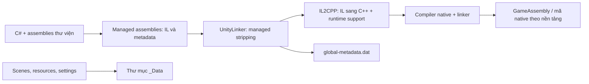

# B — Unity / IL2CPP, giải thích độc lập



C# compiler tạo managed assemblies: IL cho thân hàm, metadata mô tả kiểu, trường, phương thức, generic, tham chiếu và thuộc tính. Managed stripping dùng root và phân tích khả năng truy cập để bỏ mã/metadata không cần. Reflection và code được gọi gián tiếp cần cấu hình bảo toàn như `link.xml` hoặc `[Preserve]`; không phải mọi tên hay mọi hàm đều còn trong player. Native compiler/linker có thể loại thêm code, inline và tối ưu.

IL2CPP chuyển các assemblies sau stripping sang C++ cùng phần hỗ trợ runtime, sau đó compiler nền tảng tạo mã máy. Các ứng dụng Windows thường có EXE launcher, UnityPlayer.dll cho engine và GameAssembly.dll cho phần IL2CPP. Cách bố trí thay đổi theo nền tảng/phiên bản, không phải quy luật tuyệt đối cho mọi Unity build. `_Data` giữ dữ liệu game/scene/assets, cấu hình và dữ liệu backend; `global-metadata.dat` giúp native runtime tra kiểu, signatures và thông tin cần thiết. Nó không chứa project, comment, source C++ đã sinh hay toàn bộ IL thân hàm gốc.

Unity **Mono** thường phân phối managed assemblies có IL, có thể dịch ngược trực tiếp ở mức .NET (trừ stripping/obfuscation). **IL2CPP** đã AOT thành native: cần phối hợp metadata, registration tables, disassembly và dataflow; DLL khung dựng lại từ metadata chỉ giúp hiểu cấu trúc, không tự sinh lại logic đã mất. Kết quả dịch ngược là biểu diễn tương đương gần đúng. Không thể đảo ngược duy nhất nhiều tối ưu hóa về một source/project ban đầu.

Ví dụ hoàn toàn tự tạo:

```csharp
public sealed class Health
{
    public int Value { get; private set; } = 100;
    public void Damage(int amount)
    {
        if (amount > 0) Value = System.Math.Max(0, Value - amount);
    }
}
```

Compiler C# tạo IL cho getter/setter và `Damage`; stripping có thể loại cả lớp nếu không dùng. IL2CPP sinh C++ tương ứng, compiler native có thể inline phép trừ và clamp vào caller. Metadata còn tên `Health`/`Damage` không có nghĩa còn thân hàm IL, hoặc có một hàm native riêng cho mọi method. Pseudocode gần đúng có thể là `value = max(0, value - positive_amount)`, nhưng comment, formatting và biến source không được đảm bảo.

Nguồn Unity chính thức đã đọc:

- https://docs.unity3d.com/6000.3/Documentation/Manual/scripting-backends-il2cpp.html
- https://docs.unity3d.com/6000.3/Documentation/Manual/managed-code-stripping.html
- https://unity.com/releases/unity-6/support
